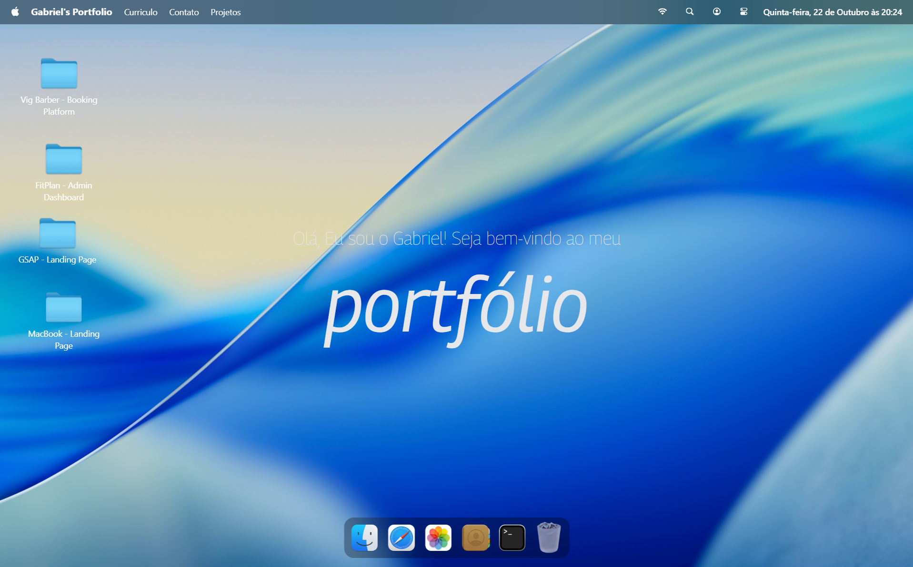
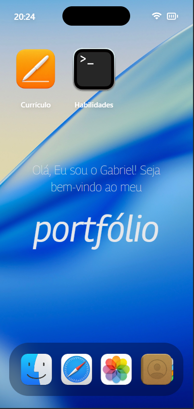
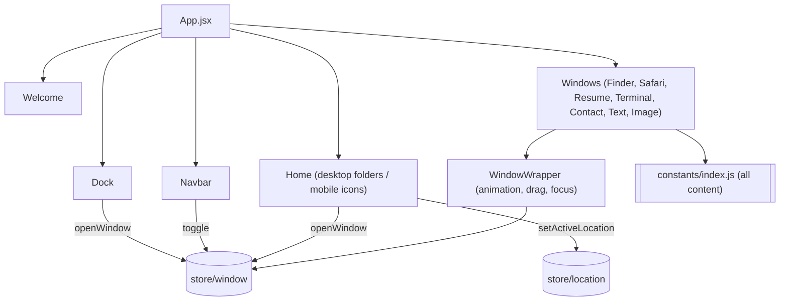

<div align="center">

# 🖥️ Gabriel's Portfolio

**A macOS-inspired portfolio that behaves like a real desktop.**
Draggable windows, a magnifying dock, a Finder to browse projects, and a full touch layout for phones and tablets.

[](https://react.dev)
[](https://vite.dev)
[](https://tailwindcss.com)
[](https://gsap.com)
[](https://zustand.docs.pmnd.rs)

[**🔗 Live demo**](https://gabriel-portfolio-snowy.vercel.app) · [**💻 GitHub**](https://github.com/Gabriel-Vignoli)

</div>

---

## 📸 Preview

<div align="center">





</div>

---

## ✨ Features

### Desktop experience
- **Window system:** open, close, focus and stack windows with z-index handling. Every window is draggable and animates in and out.
- **Finder:** browse project folders and their files (GitHub links, live sites, screenshots) with a sidebar and a grid view.
- **Draggable desktop folders:** double-click a folder to open it in Finder.
- **Dock with magnify effect:** icons scale smoothly as the cursor moves across them, with tooltips.
- **Navbar:** menu bar with date and time, window toggles and a theme switcher.

### Apps inside the portfolio
| Window | What it does |
| --- | --- |
| **Finder** | File explorer for projects, with images, text files and external links |
| **Safari** | Searchable list of certificates and courses, filterable by category |
| **Resume** | PDF viewer with zoom controls, pinch-to-zoom and double-tap zoom on touch devices |
| **Terminal** | Tech stack shown as terminal output (frontend, backend, database, tools, design, languages) |
| **Contact** | Profile and social links (GitHub, LinkedIn, Instagram, email) |
| **Text / Image viewers** | Show the about section and project screenshots |

### Polish
- 🌗 **Light, dark and system themes**, saved in `localStorage`.
- 🎬 **Intro animation sequence** built with GSAP: navbar, then welcome text, then desktop folders, then dock.
- 🔤 **Variable-font hover effect:** letters in the hero text change weight as the cursor moves.
- ♿ **Respects `prefers-reduced-motion`**, so animations are skipped for users who ask for it.
- 📱 **Phone and tablet layout:** windows become full-screen, the navbar turns into a status bar with a dynamic island, and the desktop becomes an app grid with labeled icons. The Finder uses path-based navigation with a breadcrumb.

---

## 🧱 Tech stack

| Area | Tools |
| --- | --- |
| Framework | React 19, Vite |
| Styling | Tailwind CSS 4, custom CSS layers |
| Animation | GSAP, `@gsap/react`, GSAP Draggable |
| State | Zustand (windows, location, theme) |
| PDF | react-pdf |
| UI helpers | lucide-react, react-tooltip, clsx |
| Dates | dayjs (pt-BR locale) |

The app is fully front-end. There is no backend or database, and all content lives in a single constants file.

---

## 🗂️ Projects featured

| Project | Description | Stack |
| --- | --- | --- |
| **Vig Barber** | Full-stack barbershop booking platform | Next.js, TypeScript, PostgreSQL, Prisma, NextAuth, Tailwind |
| **FitPlan Admin Dashboard** | Admin-only dashboard (access restricted) | React, Tailwind |
| **GSAP Landing Page** | Animated landing page | React, GSAP |
| **MacBook Landing Page** | MacBook Pro product page clone | React, Tailwind |
| **Restaurante Carijó** | Landing page for a restaurant | React, Tailwind |

Each project folder inside the Finder includes the GitHub repository, the live site and a screenshot.

---

## 🏗️ Architecture



**State management (Zustand)**
- `store/window.js`: open state, z-index and data payload for each window (`openWindow`, `closeWindow`, `focusWindow`).
- `store/location.js`: the folder currently open in Finder.
- `store/theme.js`: light, dark or system theme, persisted in `localStorage` and applied as a class on `<html>`.

**`WindowWrapper`** is a higher-order component that gives every window the same behavior: open and close animation, stacking, dragging on desktop and focus on click.

**Content** (nav links, dock apps, tech stack, certificates, project tree and social links) is defined in `src/constants/index.js`. The project tree is modeled as nested folders and files, which is what makes the UI feel like a real filesystem.

---

## 📁 Project structure

```
src/
├── components/
│   ├── windows/
│   │   ├── contact.jsx
│   │   ├── finder.jsx
│   │   ├── image.jsx
│   │   ├── resume.jsx
│   │   ├── safari.jsx
│   │   ├── terminal.jsx
│   │   └── text.jsx
│   ├── dock.jsx
│   ├── home.jsx
│   ├── navbar.jsx
│   ├── themeSwitcher.jsx
│   ├── welcome.jsx
│   ├── windowControls.jsx
│   └── windowWrapper.jsx
├── constants/
│   └── index.js        # all portfolio content
├── store/
│   ├── location.js
│   ├── theme.js
│   └── window.js
├── App.jsx
└── index.css           # Tailwind layers and window styles
```

---

## 🚀 Getting started

**Requirements:** Node.js 18 or newer.

```bash
# 1. Clone the repository
git clone https://github.com/Gabriel-Vignoli/gabriel-portfolio.git

# 2. Enter the project folder
cd gabriel-portfolio

# 3. Install dependencies
npm install

# 4. Start the dev server
npm run dev
```

Then open the local URL shown in the terminal (usually `http://localhost:5173`).

### Scripts

| Command | Description |
| --- | --- |
| `npm run dev` | Start the development server |
| `npm run build` | Create a production build |
| `npm run preview` | Preview the production build locally |
| `npm run lint` | Run ESLint |

---

## ✏️ Customizing the content

Everything lives in `src/constants/index.js`, so you can make the portfolio your own without touching components:

- **Add a project:** add a folder to `locations.work.children` with its GitHub link, live site and screenshot.
- **Add a certificate:** add an entry to the `courses` array with title, issuer, category, date, link and image.
- **Change the tech stack:** edit `techStack`, which feeds the Terminal window.
- **Change the dock or navbar:** edit `dockApps` and `navLinks`.

Place images in `public/images` and reference them by path.

---

## 🌐 Deployment

The app is a static Vite build and works on any static host. It is currently deployed on **Vercel**:

1. Push the repository to GitHub.
2. Import it in Vercel.
3. Keep the defaults (`npm run build`, output folder `dist`).

---


## 👤 Author

**Gabriel Vignoli**
Junior developer and Systems Analysis and Development student at FATEC Mococa, open to Junior Developer and Intern roles.

- GitHub: [@Gabriel-Vignoli](https://github.com/Gabriel-Vignoli)
- LinkedIn: [@Gabriel Vignoli](https://www.linkedin.com/in/gabriel-vignoli)

---

<div align="center">

If you like the project, a ⭐ on the repository is always appreciated.

</div>